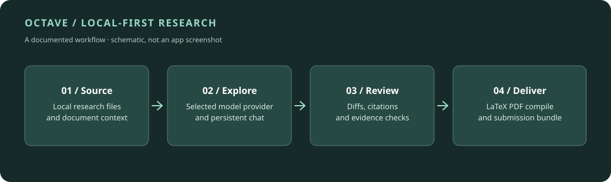

# Octave: a quick tour

**A local-first workspace for technical writing and research, with AI as an inspectable collaborator.**

Octave brings a source editor, document conversations, reviewable changes, citation and evidence checks, LaTeX compilation, and submission packaging together around ordinary local project files. It is an early release, not a hosted SaaS product or a signed consumer download.



## A five-minute guided walkthrough

1. **Open a local research folder.** Octave works with existing files rather than importing your project into a proprietary format. Choose a folder containing Markdown, LaTeX, bibliography files, and supported source material.
2. **Keep the context close to the document.** Use a project conversation for broad research, or a document conversation anchored to the current source. Pin relevant files or attach bounded extraction snapshots to a particular message.
3. **Choose your model provider.** Octave supports local Ollama, several cloud API providers, compatible command-line AI tools, and an offline demo provider. Cloud providers receive the selected context only when you ask them to process it.
4. **Review changes before applying.** Ask for a proposed edit. Octave returns a document-wide revision, displays selectable diff hunks, and writes nothing until you approve the chosen changes.
5. **Check the evidence.** Build source-grounded briefs, review citation coverage, and inspect weak or missing support. A lexical match is a review lead—not proof of a claim.
6. **Compile and prepare outputs.** Compile LaTeX, inspect the resulting PDF, and produce a bounded package for an intended submission portal. Authorship declarations and the final submission stay human decisions.

## Run the example locally

Requires Node.js 20 or newer. From a checkout:

```bash
npm install
npm run dev
```

Then open `http://127.0.0.1:3000` and select a research folder. To open Octave's bundled example automatically on macOS or Linux:

```bash
OCTAVE_ROOT="$PWD/examples/demo-workspace" npm run dev
```

On PowerShell:

```powershell
$env:OCTAVE_ROOT = "$PWD\examples\demo-workspace"
npm.cmd run dev
```

For the desktop development shell, use `npm run desktop:dev`.

## What is real, and what is next

- **Implemented and documented:** the local workstation, provider integrations, proposal/review workflow, citation checks, source inventory, PDF compilation, CLI/library, and Electron developer packaging.
- **Still pending:** signed public installers, automatic updates, and broader commercial validation.
- **Security boundary:** the service binds to loopback by default; it is single-user software without public-network authentication. Running Python and R scripts is **not** sandboxed. See [SECURITY.md](../SECURITY.md).

Read the full [README](../README.md), [desktop notes](DESKTOP.md), and [submission documentation](SUBMISSION_DESK.md) for details.
